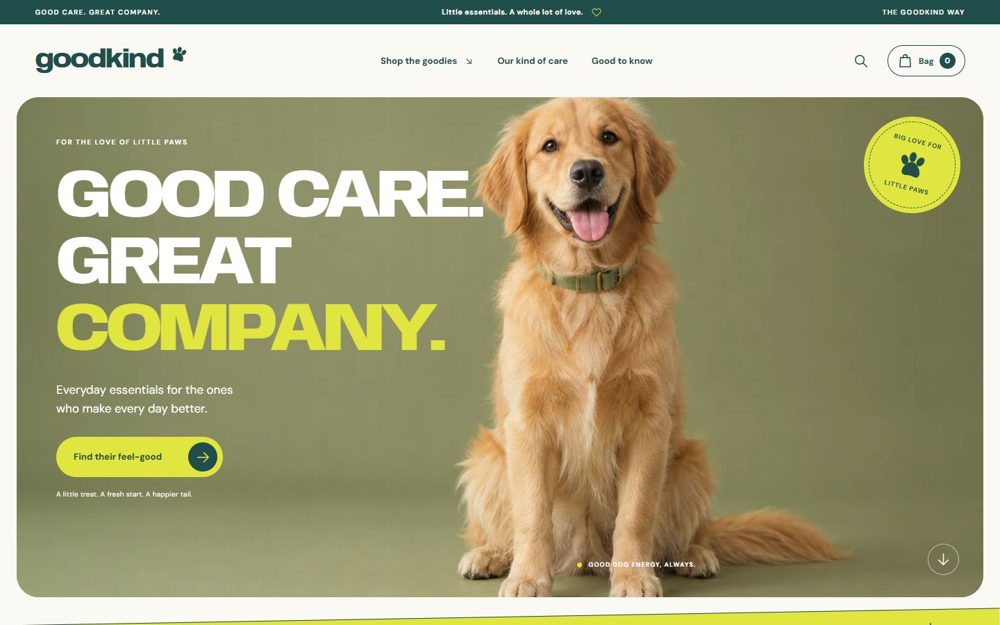

# GOODKIND

**Good care. Great company.** An English-language pet care storefront and independent portfolio concept.

A bold, warm e-commerce landing page with a forest-green and citrus palette, oversized type, original AI-generated campaign photography, and a functional browser-local shopping experience. Art direction references [Voldog](https://www.voldogfood.com/); this project is not affiliated with that brand.



[Full desktop design](docs/screenshots/desktop-full.png) · [Mobile design](docs/screenshots/mobile.png)

## Run locally

Requires Node.js 22.12+ (or 24 LTS) and npm.

```sh
npm ci
npm run dev
```

Open the URL printed by Vite (normally `http://127.0.0.1:5173`).

```sh
npm test
npm run build
npm run preview
```

## What works

- Responsive landing page, mobile navigation, and anchor navigation.
- Four products, category filters, live search, and product detail dialogs.
- A routine finder that opens the relevant product.
- Shopping bag with quantities, removal, count, totals, and a free-shipping threshold.
- Browser-local persistence with invalid stored data rejected.
- Demo checkout with an itemized summary and no payment or order submission.
- Newsletter validation and clear demo feedback; addresses are never stored or sent.
- FAQ disclosures and project/privacy/shipping information.
- Keyboard-accessible native dialogs, visible focus, labels, and reduced-motion support.
- Self-hosted fonts and optimized WebP images; no third-party runtime requests.

## Deploy when ready

Build command: `npm run build` · output directory: `dist`.

Deploy `dist` to any static host, or import this repository into Vercel, Netlify, or Cloudflare Pages with the Vite preset. The relative Vite base also supports a GitHub Pages project subdirectory. For GitHub Pages, publish the **built `dist` output**, not the raw source files. GitHub Actions checks the code and uploads the built site as an artifact; it does not deploy automatically.

This repository is saved for future deployment. No production domain or payment provider is configured.

## Project map

- `src/main.js` — page markup, dialogs, search, filters, and interaction handlers.
- `src/shop.js` — product catalog and pure cart calculations (prices in integer cents).
- `src/style.css` — design tokens, typography, responsive layouts, and motion.
- `public/images` — generated and web-optimized campaign/product assets.
- `public/fonts` — self-hosted Anybody / DM Sans and their SIL Open Font licenses.
- `tests/shop.test.js` — cart validation, mutation, total, and shipping tests.
- `docs/ASSETS.md` — asset provenance and generation prompts.
- `docs/QA.md` — verification notes.

## Portfolio scope

Goodkind, its products, prices, packaging, and policies are fictional. No real testimonials or review counts are invented. The demo is explicitly identified in checkout, newsletter, FAQ, and footer. A production shop would require a real catalog, verified product claims, inventory, backend order processing, payment integration, fulfillment, legal policies, and an actual newsletter service.

The reference uses commercial Peridot typography. This implementation uses the open-source Anybody family with a similar wide, bold character, paired with DM Sans, so the repository does not redistribute a commercial reference font.
